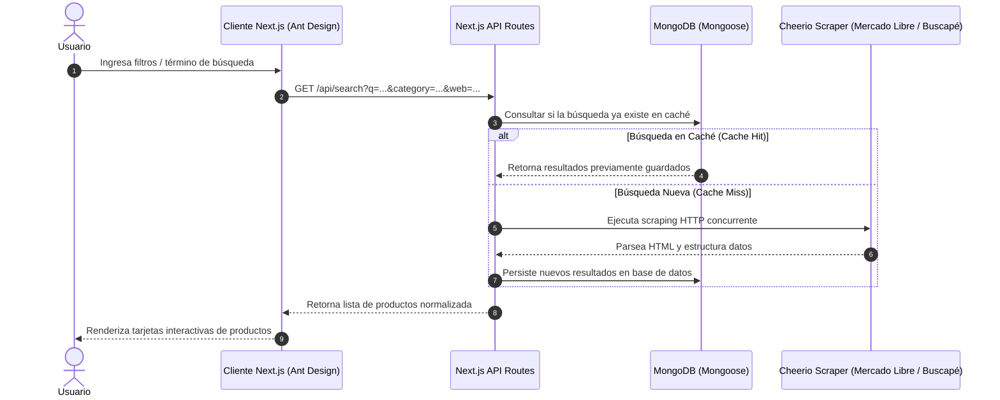

# 🔍 Next.js E-Commerce Scraper & Search Engine (Technical Interview Challenge)

[](https://nextjs.org/)
[](https://react.dev/)
[](https://www.mongodb.com/)
[](https://ant.design/)
[]()
[](https://jestjs.io/)
[](https://vercel.com/)

Solución desarrollada por **Gabriel Vázquez** como parte del **desafío técnico full stack para proceso de selección laboral (Lexart Labs)**.

La aplicación consiste en un motor de búsqueda y agregación de productos en tiempo real desarrollado en **Next.js**, que extrae información mediante **web scraping** desde **Mercado Libre** y **Buscapé**, persiste los resultados en una base de datos **MongoDB** para acelerar búsquedas repetidas (estrategia de caching) y presenta los artículos a través de una interfaz moderna construida con **Ant Design**.

---

## 🎯 Contexto del Desafío y Requerimientos

El challenge requería resolver un caso de uso real de ingeniería de software con altos estándares de calidad de código:
1. **Frontend con Next.js:** Permitir la selección de categoría (Celulares, Heladeras, TV) y plataforma de origen (Mercado Libre, Buscapé o ambas), además de un campo de búsqueda libre.
2. **Web Scraping Eficiente:** Extracción de datos en vivo (imagen, descripción, categoría, precio, link) utilizando `cheerio` y `axios`.
3. **Caché en Base de Datos (MongoDB):** Al realizar una búsqueda, almacenar los resultados; si la misma consulta se repite, retornar los registros directamente desde la base de datos sin ejecutar un nuevo proceso de scraping redundante.
4. **Principios SOLID:** Código modular, componentes con responsabilidad única (SRP) y separación limpia entre frontend, lógica de backend y capa de datos.
5. **Testing Automatizado:** Pruebas unitarias y de integración con **Jest** y **React Testing Library**.
6. **Despliegue Productivo:** Integración continua y hosting en la nube con **Vercel**.

---

## 🏗️ Arquitectura de la Solución



---

## 🛠️ Tecnologías Utilizadas

* **Framework Full Stack:** Next.js 13 (Pages Router & API Routes).
* **Biblioteca UI:** React 18 & Ant Design 5 (Icons, Grid, Card, Select, Input, Spin).
* **Persistencia:** MongoDB Atlas con Mongoose ODM.
* **Extracción de Datos:** Cheerio (DOM parsing) & Axios (HTTP client).
* **Testing:** Jest con `@testing-library/react` y `@testing-library/jest-dom`.
* **Despliegue:** Vercel CI/CD.

---

## 🚀 Puesta en Marcha Local

### 1. Clonar el Repositorio
```bash
git clone https://github.com/gavafue/challenge--gvazquez.git
cd challenge--gvazquez
```

### 2. Instalar Dependencias
```bash
npm install
```

### 3. Configurar Variables de Entorno
Crea un archivo `.env` en la raíz del proyecto con la cadena de conexión a tu clúster de MongoDB:
```env
MONGODB_URI=mongodb+srv://<usuario>:<password>@cluster0.mongodb.net/challenge_db?retryWrites=true&w=majority
```

### 4. Ejecutar Entorno de Desarrollo
```bash
npm run dev
```
La aplicación estará disponible en [http://localhost:3000](http://localhost:3000).

### 5. Ejecutar Pruebas Automatizadas
```bash
npm test
```

### 6. Compilar para Producción
```bash
npm run build
npm start
```

---

## 👤 Autor

**Gabriel Vázquez**  
*Docente de Informática & Full Stack Developer*  
* [GitHub Profile](https://github.com/gavafue)  
* [LinkedIn](https://www.linkedin.com/in/gavafue/)
